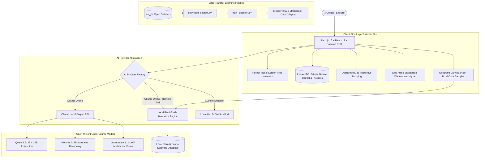

# TerraQuest AI 🌿 — Touch Grass, Not Screens
### *Your Offline AI Companion for the Real World*

[](LICENSE)
[](https://nextjs.org/)
[](https://ollama.com/)
[](src/test/)
[](#12-privacy--data-storage-behavior)
[](https://dev.to/challenges/hacktoberfest-week1-2026-10-05)

**Live Production Deployment:** [https://terraquest-ai-murex.vercel.app](https://terraquest-ai-murex.vercel.app)  
**GitHub Repository:** [https://github.com/GenX0Gravity/TerraQuestAI](https://github.com/GenX0Gravity/TerraQuestAI)  
**Hackathon Submission:** [DEV Community Hacktoberfest 2026 Week 1: Touch Grass](https://dev.to/challenges/hacktoberfest-week1-2026-10-05)

---

## 1. Project Vision & Philosophy

> **“AI should help you put your phone away, step outside, and reconnect with the real world.”**

Modern consumer technology and digital applications are overwhelmingly designed around infinite feeds, engagement notifications, and keeping people glued to glowing screens. Even outdoor and nature apps often trap users in endless digital scrolling and complex cloud sign-ins.

**TerraQuest AI** was built for the **Hacktoberfest Open-Source AI Challenge (Week 1: Touch Grass)** to invert this paradigm:
- **Success is measured by how quickly you disconnect:** The app's primary metric is how fast it equips you to explore nature, spot songbirds, identify wild flora, cultivate living soil, and put your device away.
- **100% Private & Open-Source:** No cloud telemetry, no account wall, no external token paywalls. All observations and personal journal reflections remain in local browser IndexedDB storage.
- **Resilient Offline Intelligence:** Backcountry ravines, coastal bluffs, and forest trails rarely have mobile connectivity. TerraQuest AI operates seamlessly offline using deterministic taxonomy heuristics and local open-weight vision/instruction models via **Ollama**.

---

## 2. Core Architecture



---

## 3. Honest Capability Matrix: Offline vs. Local AI vs. Network

TerraQuest AI is completely transparent about what functions without internet, what utilizes a local open-weight model, and what requires optional network access:

| Feature | 100% Offline (No Internet) | Local Ollama Model Active | Optional Network Use |
| :--- | :---: | :---: | :---: |
| **Signature "Explore & Disconnect" Pocket Mode** | ✅ Fully Functional | ✅ Enhanced Reflections | ❌ None |
| **Field Journal (Observations, Photos, Notes)** | ✅ Fully Functional (IndexedDB) | ❌ Not Needed | ❌ None |
| **Touch Grass Challenges & Badges** | ✅ Fully Functional | ❌ Not Needed | ❌ None |
| **Guided Morphology Species Identification** | ✅ Fully Functional (Local DB) | ❌ Not Needed | ❌ None |
| **Client-Side Color & Pixel Sampler** | ✅ 64×64 Offscreen Canvas | ❌ Not Needed | ❌ None |
| **Multimodal Vision Classification (Photo Upload)** | ✅ Hybrid Heuristic Engine | ✅ Real Vision (Moondream/LLaVA) | ❌ Stays Local |
| **Acoustic Birdsong Waveform Analyzer** | ✅ Real Web Audio Pipeline | ⚠️ Bioacoustic Model Ready | ❌ Stays Local |
| **Nature AI Naturalist Chat** | ✅ Local Scientific Taxonomy | ✅ Generative Open LLM | ❌ Stays Local |
| **Smart Adventure Planner** | ✅ Heuristic Route Checkpoints | ✅ Dynamic Custom Itineraries | ❌ Stays Local |
| **OpenStreetMap Nature Map** | ⚠️ Cached Offline Tiles | ❌ Not Needed | 🌐 Live OSM Tiles |
| **AI Garden Planner & Seasonal Tasks** | ✅ Microclimate Ecological Guide | ✅ Tailored Growth Advice | ❌ Stays Local |
| **Data Export / Import (CSV & JSON)** | ✅ Fully Functional | ❌ Not Needed | ❌ None |

---

## 4. Key Features Walkthrough

### A. Signature Feature: “Explore, Then Disconnect” & Pocket Mode
1. **Pick an Adventure:** Select from curated quests or plan an excursion tailored to your time (15–60 mins) and difficulty.
2. **Review Field Checklist:** Verify essentials (water, field notebook, binoculars).
3. **Activate Pocket Mode:** The application switches to an OLED-optimized, high-contrast, minimalist screen showing only your active objective, an exploration timer, and an instruction to lock your phone and put it in your pocket.
4. **Mindful Return & Reflection:** When you finish, tap *"I Have Returned — Record Discoveries"*. Record what you saw, heard, and smelled. The local AI synthesizes your notes into an encouraging reflection, awards Touch Grass XP, unlocks milestone badges, and saves the entry to your private journal.

### B. Species Identification Workspace
- **Visual Specimen Capture:** Drag-and-drop photos or use device cameras to capture plants, birds, trees, and insects.
- **Client-Side Pixel Color Sampling:** Offscreen canvas grid sampler extracts dominant hues (red, pink, green, yellow, blue) to distinguish floral petals and foliage.
- **Multimodal Open-Weight Vision:** Connects directly to local vision models (`moondream`, `llava`, `llama3.2-vision`) via Ollama with zero cloud tracking.
- **Guided Morphology Wizard:** When no camera or vision model is available, answers guided questions (leaf serrations, petal patterns, bird bill shapes, plumage coloration).
- **Strict Foraging & Safety Warnings:** Flags hazardous wild species (**Poison Ivy** contact dermatitis, **Giant Hogweed** phytophototoxicity, **Foxglove** cardiac glycosides).
- **Bioacoustic Bird-Call Analyzer:** Real-time Web Audio API recording pipeline with animated frequency spectrum and open-weight bioacoustic boundary (BirdNET-Lite ready).

### C. Smart Outdoor Adventure Planner
- Dynamically schedules 15-to-60 minute loops tailored to terrain accessibility, stroller/wheelchair needs, and nature interests.
- Generates naturalist checkpoints (canopy observation points, hedgerows, water margins) rendered on **OpenStreetMap**.

### D. Touch Grass Challenges & Gamified Milestones
- 8+ curated screen-free outdoor challenges:
  - *"The Silent Stroll"* (20 consecutive minutes outdoors without scrolling)
  - *"Avian Trio"* (Observe 3 distinct bird species)
  - *"Leaf Architect"* (Find 3 distinct leaf structures: lobed, serrated, entire)
  - *"Tender Care"* (Water a garden plant and record soil moisture)
  - *"Pollinator Patrol"* (Spend 10 minutes observing wild bees and butterflies)
- Earn naturalist XP and unlock badges without streak penalties or predatory dopamine loops.

### E. AI Garden Planner & Microclimate Calendar
- Configure microclimate settings: sunlight exposure (full, partial, shade), soil texture (loamy, sandy, clay, potting mix), and container types (balcony pots, window boxes, raised beds).
- Generates 4-season ecological schedules (Spring seeding, Summer deep hydration, Autumn seedhead retention for overwintering finches, Winter root insulation).

### F. Private, Offline-First Nature Journal
- Record field observations with photos, notes, dates, and optional GPS coordinates.
- Multi-dimensional search and category filtering.
- One-click export to **CSV** and **JSON**; instant data import for backup restoration.

---

## 5. Technology Stack

- **Framework:** Next.js 15 (App Router, Server API Proxies)
- **UI & Styling:** React 19, Tailwind CSS, Lucide Icons, Canvas Confetti
- **Client Database:** Dexie.js (IndexedDB wrapper with reactive live query hooks)
- **Mapping:** OpenStreetMap & Leaflet with tile caching
- **Local AI Engine:** Ollama HTTP REST API with internal Next.js CORS proxy
- **Audio Bioacoustics:** HTML5 Web Audio API (`AudioContext`, `AnalyserNode`)
- **Testing Suite:** Vitest (17 passing unit & integration tests)
- **Machine Learning Training Suite:** PyTorch, Torchvision, ONNX, MobileNetV3, EfficientNet

---

## 6. Installation & Local Development

### Prerequisites
- **Node.js:** v18.0.0 or higher (v20+ recommended)
- **npm:** v9+ or higher
- **Ollama (Optional for local generative AI & vision):** [https://ollama.com](https://ollama.com)

### 1. Clone the Repository
```bash
git clone https://github.com/GenX0Gravity/TerraQuestAI.git
cd TerraQuestAI
```

### 2. Install Dependencies
```bash
npm install
```

### 3. Configure Environment (Optional)
```bash
cp .env.example .env.local
```

### 4. (Optional) Run Open-Weight Models Locally via Ollama
```bash
# Recommended lightweight language model (3B parameters, ~2GB RAM):
ollama run qwen2.5:3b

# Recommended lightweight vision model for image classification (1.8B parameters):
ollama pull moondream

# Or 7B multimodal model:
ollama pull llava
```

*Note: If Ollama is not installed or running, TerraQuest AI automatically switches to its deterministic **Local Field Guide Heuristics Engine** with zero setup required!*

### 5. Launch the Development Server
```bash
npm run dev
```
Open [http://localhost:3000](http://localhost:3000) in your web browser.

---

## 7. Machine Learning & Kaggle Dataset Training Suite

For users who want to train specialized species classifiers on open-source datasets, TerraQuest AI provides a complete Python training and export pipeline in `training/`:

### Recommended Open Datasets

| Dataset | Domain | Number of Classes | Download Command |
|---|---|---|---|
| **Oxford 102 Flowers** | Roses, Sunflowers, Tulips, Orchids, Daisies... | 102 species | `python training/download_dataset.py --dataset flowers102`<br>*(Direct torchvision download, no Kaggle key required)* |
| **Birds 525 Species** | Avian species image classification | 525 species | `python training/download_dataset.py --dataset birds525`<br>*(Kaggle: `gpiosenka/100-bird-species`)* |
| **PlantVillage** | Botanical foliage & leaf health | 38 categories | `python training/download_dataset.py --dataset plantvillage`<br>*(Kaggle: `abdallahalitar/plantvillage-dataset`)* |
| **iNaturalist 2021 Mini** | Global biodiversity benchmark | 10,000 species | Kaggle dataset `inaturalist-2021` |

### Step 1: Install Python ML Requirements
```bash
pip install -r training/requirements.txt
```

### Step 2: Download the Dataset
```bash
# Download Oxford 102 Flowers automatically:
python training/download_dataset.py --dataset flowers102

# Or download Birds 525 from Kaggle (requires ~/.kaggle/kaggle.json token):
python training/download_dataset.py --dataset birds525
```

### Step 3: Train the Classifier (PyTorch Transfer Learning)
```bash
# Fine-tune MobileNetV3-Large on Oxford Flowers 102:
python training/train_classifier.py --dataset flowers102 --model mobilenet_v3_large --epochs 10 --batch-size 32

# Or train EfficientNet-B0 on custom image folder:
python training/train_classifier.py --dataset imagefolder --data-dir ./data/birds525 --model efficientnet_b0 --epochs 15
```

### Automatic Training Artifacts Exported
- `models/*_best.pt`: PyTorch model weights with highest validation accuracy.
- `models/*_species_classifier.onnx`: Cross-platform ONNX runtime model.
- `models/species_classes.json`: Complete index-to-species taxonomy mapping matching TerraQuest's schema.

---

## 8. Automated Testing & Verification

TerraQuest AI includes an automated test suite powered by **Vitest** verifying AI inference, taxonomy database integrity, morphological matching, and utility functions:

```bash
# Run unit test suite
npm run test

# Run tests in watch mode
npm run test:watch
```

### Test Suite Summary (17 Tests Passing)
- `src/test/ai-provider.test.ts` (10 tests):
  - Offline health check reporting
  - Bird taxonomy Q&A field guide retrieval
  - Toxic plant safety alerts (Poison Ivy, Giant Hogweed)
  - Morphological species identification
  - Rose botanical photo classification (validating plant vs. bird)
  - Floral color extraction (red, pink, green)
  - Filename botanical hint extraction
  - Realistic outdoor adventure planning
  - Naturalist reflection synthesis
- `src/test/nature-db.test.ts` (4 tests):
  - Database species completeness (Birds, Plants, Trees, Insects, Fungi)
  - Essential field identification attributes
  - Mandatory contact hazard warnings for hazardous flora
  - Ecosystem metadata structure
- `src/test/utils.test.ts` (3 tests):
  - Tailwind class merging
  - Human-readable date formatting
  - Relative time calculation

---

## 9. Live Demo Walkthrough & Presentation Script

**Target Time:** 3 - 5 Minutes

### Step 1: The Problem (0:00 - 0:45)
> *"Judges, society is suffering from nature deficit disorder. The average person spends over 7 hours daily looking at screens. Even existing nature apps are designed around one incentive: keeping you glued to the screen.*  
> **What if an AI app's primary measure of success was how quickly it helped you put your phone away?**  
> *Introducing **TerraQuest AI** — an offline, privacy-first open-source nature companion built for the Touch Grass Open-Source AI Challenge."*

### Step 2: Live Walkthrough (0:45 - 2:45)
1. **Launch Pocket Mode:** On the Dashboard, choose a quest and click **"Launch Pocket Mode"**. The screen becomes a minimalist OLED field card instructing: *"Lock your phone, put it in your pocket, and step outside."*
2. **Mindful Return:** After exploring, tap *"I Have Returned"*. Enter what you heard and smelled. The local AI synthesizes a naturalist reflection, awards Touch Grass XP, unlocks a milestone badge, and logs it to your private journal.
3. **Specimen Identification:** In the **Identify** workspace, upload a photo or use the Guided Morphology Wizard. Client-side pixel sampling detects petal colors and leaf structures, matching against the local taxonomy database with strict safety warnings.
4. **Smart Adventure Planner:** Tailors 15-to-60 minute walking loops rendered on OpenStreetMap.

### Step 3: Why Open Innovation Matters (2:45 - 3:45)
1. **Privacy:** Journal entries and GPS points stay in local IndexedDB.
2. **Offline Resilience:** Works 100% offline in deep backcountry ravines and trails.
3. **Zero Operating Costs:** Free open-weight models with zero subscriptions.
4. **Model Agility:** One-click model switching in Settings.

---

## 10. Safety, Botanical Reliability & Environmental Ethics

1. **Strict Foraging Caution:** Never consume wild plants, berries, or fungi based solely on AI or app identification. Always verify with an expert botanist.
2. **Contact Hazards:** Proactively warns against hazardous plants like **Poison Ivy** (*Toxicodendron radicans*) and **Giant Hogweed** (*Heracleum mantegazzianum*).
3. **Leave No Trace:** Instructs users to observe wildlife from a respectful distance, leave active nests undisturbed, and avoid trampling micro-ecosystems.
4. **Honest AI Status:** Never hallucinates certainty; candidate species are presented with confidence ratings and similar alternatives.

---

## 11. Why Open Innovation Matters

| Dimension | Proprietary Commercial Nature Apps | TerraQuest AI (Open-Source Architecture) |
| :--- | :--- | :--- |
| **User Data Privacy** | Journal entries & GPS tracks stored on commercial cloud servers | **100% on-device** in local browser IndexedDB |
| **Operating Cost** | Recurring subscription or per-token API charges | **Zero operating costs**; free and self-hosted |
| **Offline Resilience** | Completely breaks without internet / cell signal | **Runs 100% offline** in remote nature trails & woods |
| **Model Freedom** | Hardcoded to one proprietary vendor | **Switchable** between Qwen, Gemma, Llama, and Moondream |
| **Core Incentive** | Maximize screen time, ad impressions, and app stickiness | **Minimize screen time**; encourage stepping outside |

---

## 12. Privacy & Data Storage Behavior

- **IndexedDB:** All user data (observations, photos, adventure missions, challenges, XP, badges) is stored entirely in the user's browser using Dexie.js.
- **Zero Cloud Telemetry:** No analytics trackers, no advertising beacons, no third-party telemetry scripts.
- **Local AI Endpoint:** When using Ollama, requests stay on `localhost:11434` via an internal Next.js API route proxy.
- **Data Portability:** Full one-click JSON backup export and import under Settings.

---

## 13. Deployment Guide & Live Verification

**Verified Live Deployment:** [https://terraquest-ai-murex.vercel.app](https://terraquest-ai-murex.vercel.app)

### Deploying to Vercel (Production Setup)
1. Fork or push the repository to GitHub: `https://github.com/GenX0Gravity/TerraQuestAI`
2. Import the project into [Vercel](https://vercel.com/new).
3. Framework preset: **Next.js**.
4. Build command: `npm run build`. Output directory: `.next`.
5. Environment variables (optional):
   ```
   NEXT_TELEMETRY_DISABLED=1
   ```
6. Click **Deploy**. Vercel will build and serve the application globally.

*Note for deployed environments: In web-hosted deployments, the client-side IndexedDB journal, Pocket Mode, OpenStreetMap, Web Audio, and offline Field Guide Heuristics Engine run directly in the browser. For local LLM generative chat, users run Ollama on their machine.*

---

## 14. Contributing Guidelines

We welcome contributions to **TerraQuest AI — Touch Grass, Not Screens**!

### Guiding Principles
1. **Real-World First:** Features must help people explore outdoors, learn about biodiversity, or disconnect from devices. Avoid features that encourage endless scrolling.
2. **Open-Source & Local-First:** Keep local inference (Ollama, open-weight models, deterministic offline heuristics) as the primary intelligence mechanism. Never hardcode paid proprietary API keys as requirements.
3. **Privacy & Offline Resilience:** All observations, location coordinates, and journal reflections must remain on the user's device by default.
4. **Botanical & Wildlife Safety:** Never encourage users to touch unknown stinging plants or consume wild mushrooms without verified botanist inspection.

### Pull Request Checklist
- [ ] Code adheres to TypeScript strict typing (no untyped `any`).
- [ ] Unit tests added or updated in `src/test/`.
- [ ] `npm run test` passes with 100% success.
- [ ] `npm run build` compiles with zero errors.
- [ ] Safety warnings preserved for wild species identification.

---

## 15. License

Licensed under the [Apache License, Version 2.0](LICENSE). You may use, reproduce, modify, and distribute this software in accordance with the terms of the License.

---

*“Step outside, take a deep breath, and touch grass.”* 🌿
