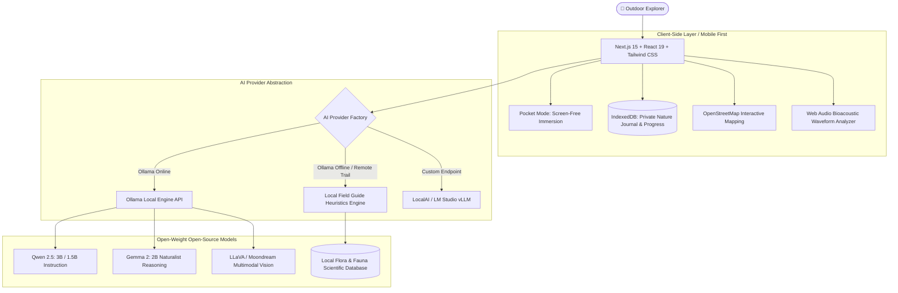

# TerraQuest AI 🌿 — Touch Grass, Not Screens
### *Your Offline AI Companion for the Real World*

[](LICENSE)
[](https://nextjs.org/)
[](https://ollama.com/)
[](vitest.config.ts)
[](#privacy-first-local-storage)

---

## 1. Project Vision & Philosophy

> **“AI should help you put your phone away, step outside, and reconnect with the real world.”**

Modern technology and AI products are too often designed around infinite scrolling, engagement notifications, and keeping people glued to glowing rectangles.

**TerraQuest AI** is built for the **“Touch Grass” Open-Source AI Challenge**. It flips the technology paradigm on its head: **success is measured not by how long you stay inside the application, but by how quickly it equips you to explore nature, spot songbirds, discover native flora, cultivate soil, and put your phone away.**

Built with **open-source AI at its core**, TerraQuest AI runs local open-weight instruction and vision models (such as **Qwen 2.5**, **Gemma 2**, and **LLaVA/Moondream**) via **Ollama**, backed by a resilient, deterministic **100% offline field guide engine** and client-side **IndexedDB** database. It works seamlessly in deep backcountry ravines and urban pocket parks alike.

---

## 2. Core Architecture



---

## 3. Honest Offline, Local & Network Capability Matrix

TerraQuest AI is completely transparent about what works without an internet connection, what requires a local model server, and what features use network services:

| Feature | 100% Offline (No Internet) | Local Ollama Model Active | Optional Network Use |
| :--- | :---: | :---: | :---: |
| **Signature "Explore & Disconnect" Pocket Mode** | ✅ Fully Functional | ✅ Enhanced Reflections | ❌ None |
| **Field Journal (Observations, Photos, Reflections)** | ✅ Fully Functional (IndexedDB) | ❌ Not Needed | ❌ None |
| **Touch Grass Challenges & Badges** | ✅ Fully Functional | ❌ Not Needed | ❌ None |
| **Naturalist Guided Morphology Identification** | ✅ Fully Functional (Local DB) | ❌ Not Needed | ❌ None |
| **Multimodal Vision Classification (Photo Upload)** | ⚠️ Guided Fallback | ✅ Real Vision (LLaVA/Moondream) | ❌ Stays Local |
| **Acoustic Birdsong Waveform Analyzer** | ✅ Real Web Audio Pipeline | ⚠️ Model Boundary Ready | ❌ Stays Local |
| **Nature AI Conversational Assistant** | ✅ Local Field Taxonomy Heuristics | ✅ Generative Open-Weight AI | ❌ Stays Local |
| **Smart Adventure Planner** | ✅ Full Heuristic Planning | ✅ Custom Dynamic Itineraries | ❌ Stays Local |
| **OpenStreetMap Nature Map** | ⚠️ Cached Offline Tiles | ❌ Not Needed | 🌐 Live OSM Tiles |
| **AI Garden Planner & Seasonal Calendar** | ✅ Full Microclimate Guidance | ✅ Tailored Ecological Advice | ❌ Stays Local |
| **Data Export / Import (CSV & JSON)** | ✅ Fully Functional | ❌ Not Needed | ❌ None |

---

## 4. Feature Deep-Dive

### A. Signature Feature: “Explore, Then Disconnect” & Pocket Mode
1. **Choose an Outdoor Mission:** Select a daily mission or generate a custom 15-to-60 minute quest.
2. **Pack Checklist:** Review what to bring (water, field notebook, binoculars).
3. **Switch to Pocket Mode:** The screen transforms into an ultra-clean, OLED-friendly, high-contrast field display showing only the active step, a gentle outdoor exploration timer, and instructions to lock your phone and put it in your pocket.
4. **Return & Reflect:** Upon returning, tap *"I Have Returned — Record Discoveries"*. Record the species you noticed and sensory observations (scents, sounds, weather). The local AI generates a mindful debrief, awards Touch Grass XP, unlocks badges, and automatically records the entry into your private journal.

### B. Bird and Plant Identification Workspace
- **Multimodal Image Upload & Camera Capture:** Drag-and-drop photos or use device cameras to capture field specimens.
- **Local Vision Model Execution:** Evaluated via open-weight vision models (e.g. `llava`, `moondream`) when configured.
- **Guided Morphology Wizard (Honest Fallback):** If vision models are offline or unavailable, users answer guided morphological questions (leaf lobes, saw-blade serrations, bird beak silhouettes, plumage colors, habitats). Matches against the local scientific database.
- **Strict Foraging & Safety Warnings:** Displays prominent field hazard alerts for poisonous species (e.g., Poison Ivy urushiol dermatitis, Giant Hogweed phototoxic blisters, Foxglove cardiac toxicity).
- **Acoustic Bird-Call Interface:** Working Web Audio API audio recorder with live animated frequency spectrum and open-weight bioacoustic boundary (BirdNET / Whisper).

### C. Smart Outdoor Adventure Planner
- Plans excursions based on available time (15m, 30m, 45m, 60m), difficulty (Gentle Stroll, Moderate Exploration, Active Trek), modality (walking, hiking, cycling, mindful forest bathing), accessibility requirements, and botanical interests.
- Generates naturalist checkpoints along the route and renders routes on **OpenStreetMap**.

### D. Touch Grass Challenges & Gamified Milestones
- 8+ curated screen-free outdoor challenges:
  - *"The Silent Stroll"* (20 consecutive minutes outdoors without scrolling)
  - *"Avian Trio"* (Observe 3 different bird species)
  - *"Leaf Architect"* (Find 3 distinct leaf structures: lobed, serrated, entire)
  - *"Tender Care"* (Water a garden plant and record growth)
  - *"Bee & Butterfly Watch"* (Spend 10 minutes observing wild pollinators)
- Earn XP, unlock naturalist badges, and celebrate real-world curiosity without streak anxiety or social media pressure.

### E. AI Garden Planner & Seasonal Care Calendar
- Enter microclimate parameters: sunlight hours (full, partial, shade), soil characteristics (loamy, sandy, clay, potting mix), and space type (balcony pots, window boxes, raised beds, backyard plots).
- Generates four-season ecological care tasks (Spring sowing, Summer deep watering, Autumn seedhead retention for winter birds, Winter pot insulation).

### F. Private, Offline-First Nature Journal
- Full observation history with photos, notes, dates, and optional GPS coordinates.
- Multi-dimensional search and category filters (Birds, Plants, Trees, Insects).
- One-click export to **CSV** and **JSON** backups; instant import for data migration.

### G. Model Registry & Settings
- Model switcher: swap between Ollama open-weight models (`qwen2.5:3b`, `gemma2:2b`, `llama3.2:3b`, `moondream`) or the offline heuristics engine.
- Live test connection button measuring ping latency.
- Custom local endpoint support (LM Studio, LocalAI, vLLM).

---

## 5. Getting Started & Installation

### Prerequisites
- **Node.js:** v18.0.0 or higher (v20+ recommended)
- **npm:** v9+ or higher
- **Ollama (Optional for local LLM generation):** [ollama.com](https://ollama.com/)

### 1. Clone & Install
```bash
git clone https://github.com/GenX0Gravity/TerraQuestAI.git
cd TerraQuestAI
npm install
```

### 2. Configure Environment (Optional)
```bash
cp .env.example .env.local
```

### 3. (Optional) Start Local Ollama Models
Download and run your chosen open-weight model:
```bash
# Recommended lightweight model (Fast, low RAM usage)
ollama run qwen2.5:3b

# Or alternative lightweight models
ollama run gemma2:2b
ollama run llama3.2:3b

# Optional vision model for photo recognition
ollama pull moondream
```

*Note: If Ollama is not running, TerraQuest AI automatically activates its deterministic **Local Field Guide Heuristics Engine** with zero configuration required!*

### 4. Run Development Server
```bash
npm run dev
```
Open [http://localhost:3000](http://localhost:3000) in your web browser.

---

## 6. Testing

TerraQuest AI includes a comprehensive test suite powered by **Vitest** verifying AI inference, taxonomy database integrity, morphological matching, and utility functions:

```bash
# Run unit test suite
npm run test

# Run tests in watch mode
npm run test:watch
```

Test coverage includes:
- `src/test/ai-provider.test.ts`: Offline chat, bird Q&A, toxic plant safety warnings, morphological species matching, adventure planning, and reflection synthesis.
- `src/test/nature-db.test.ts`: Taxonomy completeness, distinguishing features, contact hazard notices (Poison Ivy, Giant Hogweed, Foxglove), and ecosystem metadata.
- `src/test/utils.test.ts`: Tailwind class merges, human-readable date formatting, and relative time calculation.

---

## 7. Safety, Botanical Reliability & Environmental Ethics

1. **Strict Foraging Caution:** TerraQuest AI enforces a strict protocol: **Never consume wild plants, berries, or fungi based solely on AI or app identification.** Always verify with an expert botanist.
2. **Contact Hazards:** The application actively flags hazardous species like **Poison Ivy** (*Toxicodendron radicans*) and **Giant Hogweed** (*Heracleum mantegazzianum*) to protect outdoor explorers.
3. **Leave No Trace:** Missions explicitly instruct users to observe living species from a respectful distance, leave active nests undisturbed, and avoid trampling fragile micro-ecosystems.
4. **Honest AI Status:** The application never hallucinates certainty. Candidate species are explicitly presented with confidence ratings and similar alternatives.

---

## 8. Why Open Innovation Matters

| Dimension | Proprietary Commercial AI Apps | TerraQuest AI (Open-Source Architecture) |
| :--- | :--- | :--- |
| **User Data Privacy** | Journal entries & GPS tracks stored on commercial servers | **100% on-device** in local browser IndexedDB |
| **Operating Cost** | Recurring subscription or per-token API charges | **Zero operating costs**; free and self-hosted |
| **Offline Resilience** | Completely breaks without internet / cell signal | **Runs 100% offline** in remote nature trails & woods |
| **Model Freedom** | Hardcoded to one provider; subject to changes | **Switchable** between Qwen, Gemma, Llama, and Moondream |
| **Core Incentive** | Maximize screen time, ad impressions, and app stickiness | **Minimize screen time**; encourage stepping outside |

---

## 9. Technology Stack

- **Framework:** Next.js 15 (App Router, Server API Proxies)
- **UI & Components:** React 19, Tailwind CSS, Lucide Icons
- **Local Persistence:** Dexie.js (IndexedDB wrapper with live query hooks)
- **Mapping:** OpenStreetMap & Leaflet with offline tile support
- **Local AI Engine:** Ollama HTTP REST API with automated Next.js CORS proxy
- **Audio Bioacoustics:** HTML5 Web Audio API (`AudioContext`, `AnalyserNode`)
- **Testing:** Vitest

---

## 10. License

Licensed under the [Apache License, Version 2.0](LICENSE). You may use, reproduce, modify, and distribute this software in accordance with the terms of the License.

---

*“Step outside, take a deep breath, and touch grass.”* 🌿
